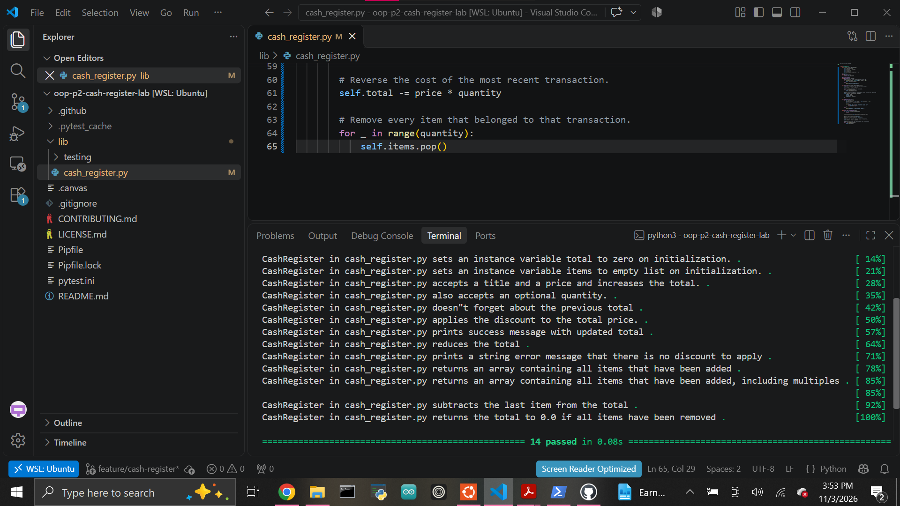

# Cash Register OOP Lab

A Python object-oriented programming project that models the basic behavior of a cash register.

The project demonstrates classes, instance attributes, properties, setters, validation, methods, transaction history, and basic state management.

## Features

The `CashRegister` class supports:

- Creating a register with an optional percentage discount
- Validating discounts between 0 and 100
- Tracking the current total
- Adding individual items or multiple quantities
- Tracking purchased items
- Recording previous transactions
- Applying percentage discounts
- Voiding the most recent transaction
- Updating the total and item list when a transaction is voided

## CashRegister Attributes

`discount`  
Stores the percentage discount applied to the register. The value must be an integer between 0 and 100.

`total`  
Stores the current price of all items added to the register.

`items`  
Stores the names of all individual items added to the register.

`previous_transactions`  
Stores information about transactions so the most recent transaction can be reversed.

## Methods

### `add_item(item, price, quantity=1)`

Adds an item to the cash register.

The method:

- Adds the item's price to the total
- Supports an optional quantity
- Adds each purchased item to the `items` list
- Records the transaction in `previous_transactions`

Example:

```python
register.add_item("book", 5.00, 3)
```

The total increases by `$15.00`.

### `apply_discount()`

Applies the register's percentage discount to the current total.

Example:

```python
register = CashRegister(20)
register.add_item("macbook air", 1000)
register.apply_discount()
```

Output:

```text
After the discount, the total comes to $800.
```

If no discount is available:

```text
There is no discount to apply.
```

### `void_last_transaction()`

Reverses the most recently added transaction.

The method:

- Removes the most recent transaction from the transaction history
- Subtracts its price from the total
- Removes the associated items from the items list

If there is no transaction to void:

```text
There is no transaction to void.
```

## Discount Validation

The `discount` property accepts only integers between `0` and `100`, inclusive.

Invalid values print:

```text
Not valid discount
```

## Technologies

Python 3.8.13  
Pytest  
Pipenv  
Git and GitHub

## Setup

Clone the repository and enter the project directory.

```bash
git clone git@github.com:Abraham-z14/oop-p2-cash-register-lab.git
cd oop-p2-cash-register-lab
```

Install the environment:

```bash
pipenv --python ~/.pyenv/versions/3.8.13/bin/python install
pipenv shell
```

Run the test suite:

```bash
pytest
```

## Test Results

The project passes all provided automated tests.

```text
14 passed
```



## Project Structure

```text
oop-p2-cash-register-lab/
├── images/
│   └── tests-passing.png
├── lib/
│   ├── cash_register.py
│   └── testing/
├── Pipfile
├── Pipfile.lock
├── pytest.ini
└── README.md
```

## Author

Abraham Zarate